 

## Sobre

Estudante do 8º semestre de Engenharia da Computação no UniCEUB e estagiário de Desenvolvimento Backend Java e DevOps na Defensoria Pública do Distrito Federal (DPDF), em Brasília.

Trabalho principalmente com **Java e Spring Boot**, construindo APIs REST e microsserviços integrados a bancos SQL. Também trabalho bastante com **LLMs e IA generativa**: uso no dia a dia para desenvolvimento e automação, e em agentes e fluxos com n8n que conectam sistemas, APIs e rotinas de dados.

## Projeto principal

O código-fonte fica em repositório privado.

## Tecnologias

| Área | Stack |
| :-- | :-- |
| Linguagens |  |
| Backend |  |
| Frontend |  |
| DevOps |  |
| IA e automação | LLMs e IA generativa, agentes de IA, n8n |
| Hardware e IoT |  &nbsp; Arduino, ESP32 e ESP32-S3-CAM (visão computacional) |

## Experiência

| Período | Cargo | Atuação |
| :-- | :-- | :-- |
| 02/2026 até hoje | **Estagiário de Backend Java e DevOps** Defensoria Pública do DF (DPDF) | Sistemas e rotinas corporativas em Java com Spring Boot, APIs e microsserviços com bancos SQL, e automação de fluxos de trabalho com n8n. |
| 01/2026 a 02/2026 | **Estagiário de TI** Tribunal Superior do Trabalho (TST) | Suporte técnico, infraestrutura de redes e demandas internas de tecnologia. |
| 01/2025 a 06/2025 | **Estagiário de Suporte de TI e Desenvolvimento** B2G | Desenvolvimento em Java e Python para soluções corporativas internas e suporte a usuários. |

## Outros projetos

| Projeto | Descrição | Tecnologia |
| :-- | :-- | :-: |
| [Portfólio](https://julio-cesar.dev/) ([código](https://github.com/Juli0cso/portfolio)) | Site pessoal com formação e atuação em backend | TypeScript |
| [API Sistema de Estoque](https://github.com/Juli0cso/API-Sistema-de-estoque-C-Sharp) | API para controle de estoque | C# |
| Visão computacional embarcada | Identificação de objetos e cores com ESP32-S3-CAM | C/C++ |

## Atividade no GitHub

<picture>
  <source media="(prefers-color-scheme: dark)" srcset="https://raw.githubusercontent.com/Juli0cso/Juli0cso/output/pacman-contribution-graph-dark.svg" />
  <source media="(prefers-color-scheme: light)" srcset="https://raw.githubusercontent.com/Juli0cso/Juli0cso/output/pacman-contribution-graph.svg" />
  
</picture>

## Contato

- LinkedIn: [linkedin.com/in/juli0cso](https://www.linkedin.com/in/juli0cso)
- E-mail: [jc.nizuu@gmail.com](mailto:jc.nizuu@gmail.com)
- Portfólio: [julio-cesar.dev](https://julio-cesar.dev/)
- Localização: Brasília, DF
